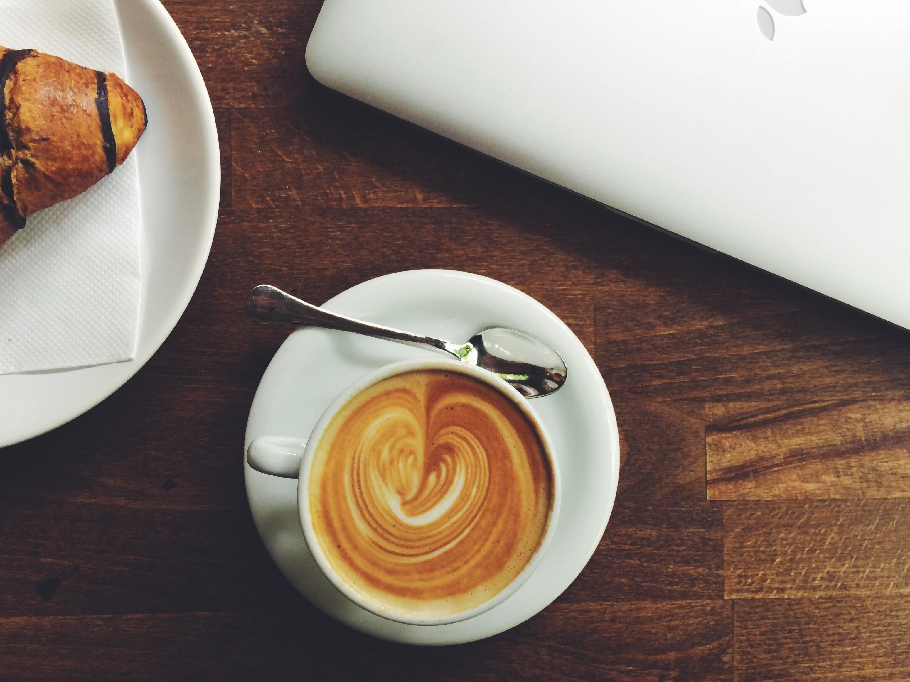

# Bloom & Bean Café – WEDE5020 POE Part 2

**Student:** Carina [surname] · **Student number:** [number]
**Module:** WEDE5020 · **Submission:** Part 2 – Styling & Responsive Design

A five-page responsive website for Bloom & Bean Café, a plant-filled coffee shop in Stellenbosch, Western Cape.

---

## 1. Project structure

```
bloom-and-bean/
├── index.html          Home
├── about.html          Our story, mission, vision, team
├── menu.html           Coffee, Breakfast, Lunch, Baked Goods
├── enquiry.html        Bookings & event enquiry form
├── contact.html        Contact details, form, maps
├── css/
│   └── styles.css      ONE shared external stylesheet (linked by all 5 pages)
├── images/             Original photos + generated responsive versions
├── screenshots/        Responsive testing evidence (desktop / tablet / mobile)
├── resize-images.py    Generates the -400 / -800 / -1200 .jpg and .webp versions
└── README.md
```

## 2. External stylesheet

All CSS now lives in **`css/styles.css`** and every page links it in the `<head>`:

```html
<link rel="stylesheet" href="css/styles.css" />
```

* No `<style>` blocks and no inline `style=""` attributes remain in any HTML file.
* The ~400 lines of CSS that were duplicated in each page (reset, header/nav, buttons, forms, footer, etc.) now exist **once**.
* The file is organised in numbered sections (reset → header → buttons → hero → … → footer → responsive).
* Page-specific styles are kept in their own labelled sections (Hero, About, Menu, Enquiry, Contact).
* Small differences between pages are handled with modifier classes rather than copies, e.g. `.page-header--menu` (different background photo) and `.enquiry-form .btn` (full-width submit button).
* The shared `.required` class replaces the inline red asterisks, and `.map-note` replaces the inline map-placeholder styling.

## 3. Responsive design

Layouts use **CSS Grid** (page sections, menu, team, footer, forms) and **Flexbox** (navigation, hero buttons, list items). Layouts restructure at three breakpoints:

| Breakpoint | Device | Main changes |
|---|---|---|
| `max-width: 992px` | Tablet landscape | Enquiry, contact and map grids go to one column |
| `max-width: 768px` | Tablet portrait | Nav stacks and wraps; menu & team go to 2 columns; about, mission/vision and form rows go to 1 column; smaller headings |
| `max-width: 480px` | Phone | Menu, team and feature grids go to 1 column; footer centred and stacked; smaller hero |

## 4. Responsive images

Menu photos and the About-page photo now use `<picture>`, `srcset`, `sizes`, `width`/`height`, and lazy loading:

```html
<picture>
  <source type="image/webp"
          srcset="images/Espresso-400.webp 400w, images/Espresso-800.webp 800w"
          sizes="(max-width: 480px) 100vw, (max-width: 992px) 50vw, 380px" />
  
</picture>
```

* **`srcset` + `sizes`** let the browser download a 400px image on a phone and an 800px image on a large screen, instead of always downloading one big file.
* **`<picture>` with WebP** serves a smaller modern format to browsers that support it; the JPG is the fallback.
* **`width` / `height`** reserve space so the page does not jump while images load.
* **`loading="lazy"`** delays images that are off-screen.
* The extra sizes are generated from the original photos by `resize-images.py` (`pip install pillow`, then `python resize-images.py`). The originals are never modified.

## 5. Accessibility & quality notes

* Every image has meaningful `alt` text; decorative placeholder icons are `aria-hidden`.
* Form fields use `<label for>` linked to each input, with visible focus styles.
* Each page has a unique `<title>` and `<meta name="description">`.
* `lang="en"` and the viewport meta tag are set on every page.

## 6. Testing (browser DevTools)

Tested using Chrome DevTools → Device Toolbar. Screenshots are in the `screenshots/` folder.

| Page | Desktop (1440px) | Tablet (768px) | Mobile (375px) |
|---|---|---|---|
| Home | `screenshots/desktop-index.png` | `screenshots/tablet-index.png` | `screenshots/mobile-index.png` |
| About | `screenshots/desktop-about.png` | `screenshots/tablet-about.png` | `screenshots/mobile-about.png` |
| Menu | `screenshots/desktop-menu.png` | `screenshots/tablet-menu.png` | `screenshots/mobile-menu.png` |
| Enquiry | `screenshots/desktop-enquiry.png` | `screenshots/tablet-enquiry.png` | `screenshots/mobile-enquiry.png` |
| Contact | `screenshots/desktop-contact.png` | `screenshots/tablet-contact.png` | `screenshots/mobile-contact.png` |

Checks performed on each page at each size: no horizontal scrolling, navigation usable, images load at the correct size (Network tab → `srcset` candidate chosen), forms usable, footer readable.

## 7. Feedback and changes

### 7.1 Part 1 lecturer feedback

> **[PASTE THE LECTURER'S PART 1 FEEDBACK HERE]**

| # | Part 1 feedback | Change made | Where |
|---|---|---|---|
| 1 | [feedback point] | [what you changed] | [file / section] |
| 2 | [feedback point] | [what you changed] | [file / section] |
| 3 | [feedback point] | [what you changed] | [file / section] |

### 7.2 Part 2 feedback and corrections

| Feedback | Correction |
|---|---|
| No external CSS stylesheet; CSS embedded in each page and duplicated | Created `css/styles.css`, removed every `<style>` block and inline style, linked the stylesheet from all five pages |
| No responsive images (`srcset`, `sizes`, `<picture>`) | Added `<picture>`, `srcset`, `sizes`, WebP sources, `width`/`height` and lazy loading to the menu and About images; added `resize-images.py` to generate the sizes |
| README contained only the title | Wrote this full documentation |
| No record of Part 1 feedback changes | Added section 7.1 changelog |
| No references | Added section 8 |
| No desktop / tablet / mobile testing screenshots | Added `screenshots/` folder and testing table (section 6) |

## 8. References

> Adjust the format to the referencing style required by your institution and add the date you accessed each source.

* Google Fonts (n.d.) *Playfair Display* and *Lato*. Available at: https://fonts.google.com (Accessed: [date]).
* Font Awesome (n.d.) *Font Awesome 6 free icons*, served via cdnjs. Available at: https://fontawesome.com (Accessed: [date]).
* MDN Web Docs (n.d.) *Responsive images*. Mozilla. Available at: https://developer.mozilla.org/en-US/docs/Learn_web_development/Core/Structuring_content/HTML_images#responsive_images (Accessed: [date]).
* MDN Web Docs (n.d.) *Using CSS media queries*. Mozilla. Available at: https://developer.mozilla.org/en-US/docs/Web/CSS/CSS_media_queries/Using_media_queries (Accessed: [date]).
* MDN Web Docs (n.d.) *CSS grid layout* and *CSS flexible box layout*. Mozilla. Available at: https://developer.mozilla.org/en-US/docs/Web/CSS (Accessed: [date]).
* [Add any other source you used, including AI tools, and the lecturer's brief: WEDE5020 POE 2026.]

© 2026 Bloom & Bean Café – student project.
